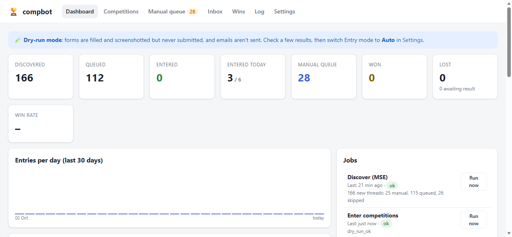

# compbot 🏆

A self-hosted competition assistant for TrueNAS SCALE (or any Docker host). Every day it:



1. **Discovers** new competitions posted in MoneySavingExpert's [Competitions Time](https://forums.moneysavingexpert.com/categories/competitions-time) forum (via the forum's public API), plus, optionally, [Competitions-Time.co.uk](https://www.competitions-time.co.uk) and [Competition Database](https://www.competitiondatabase.co.uk). The same comp found on several sites, or posted twice, is kept as **one** competition and entered once (see [Where competitions come from](#where-competitions-come-from)).
2. **Triages** each one: web form, email entry, Instagram/Facebook/X, Gleam, app/account-only, purchase-required, magazine puzzles. It pulls out the closing date, entry link(s), the answer posted by other members, and "daily" / multi-site (MD) flags.
3. **Enters** the ones it can, using your saved details: it fills web forms in a headless Chromium (Playwright) and sends email entries from your competition Gmail. It takes screenshots before and after every submission.
4. **Checks your competition Gmail** (Inbox and Spam) for wins among the noise. It scores each email, matches it to a competition you entered, clicks "confirm your entry" links, flags likely scams, and alerts you on a possible win.
5. **Logs everything** in a SQLite database with a web GUI covering the dashboard, every competition and attempt, a manual queue, an inbox triage view, wins and an activity log.

## What it deliberately won't do

* **Solve CAPTCHAs or dodge bot detection.** If a form has reCAPTCHA, hCaptcha or Turnstile, or the site blocks automation, the comp goes to your **manual queue** with a screenshot. That includes the checks that only speak up after you press submit: a hidden reCAPTCHA saying "Unable to verify" or "The security code does not match", a button stuck on "Solving captcha…", Klaviyo sign-up forms answering "An error occurred when submitting", and simple sums such as "9 + 3 equals" or "9 – 5 =" (a CAPTCHA by another name, never answered by compbot or its AI). These go to you on the first try instead of being retried.
* **Ignore the rules.** Many UK T&Cs say *"entries made using a script, macro or automated means will be void"*. compbot reads the page and its T&Cs and, by default, sends those comps to the manual queue with the exact clause quoted. An automated entry there could cost you the prize.
* **Use your social media accounts.** Instagram/Facebook/X comps are skipped, or queued for you if you prefer.
* **Spend money.** Purchase-required comps are skipped.

Expect roughly a third to a half of web-form comps to be enterable automatically. The rest land in the manual queue with everything you need: the link, the answer and click-to-copy details.

## Install on TrueNAS SCALE (24.10 Electric Eel or later)

### 1. Prepare a Gmail account for competitions

1. Turn on **2-Step Verification** for the Google account.
2. Create an **App password** at <https://myaccount.google.com/apppasswords>, named e.g. "compbot".
3. IMAP is on by default for Gmail. compbot only reads mail (it never deletes or marks it as read).

### 2. Create a dataset

In **Datasets**, create e.g. `tank/apps/compbot` (the "Apps" preset is fine). It must be writable by the **apps** user (UID/GID 568), which is the user the container runs as. The database and screenshots live here, so include it in your snapshots and backups.

### 3. Get the image onto the NAS

**Option A: GitHub Container Registry (default in `truenas-app.yaml`)**

Every push to `main` runs `.github/workflows/docker.yml` on GitHub's free hosted runners (no self-hosted runner needed). It runs the tests, then publishes `ghcr.io/rk110038/compbot:latest`. Because the repo is public, the package is public too, so TrueNAS can pull it without credentials. (If you ever make the repo private, either make the package public under **github.com/rk110038 → Packages → compbot → Package settings**, or add a GHCR credential in TrueNAS.) To update, push, wait for the Action to go green, then stop and start the app in TrueNAS so it re-pulls the image. The Ollama service (`compbot:ollama-latest`, rebuilt daily from the latest Ollama by `.github/workflows/ollama-image.yml`) also has `pull_policy: always`, so the same stop/start picks up Ollama fixes too (new models such as Gemma 4 often need a recent Ollama). If you installed from an older copy of the YAML, add that line to the `ollama` service.

**Option B: build on the NAS**

Copy this folder to the NAS (for example into `/mnt/tank/apps/compbot-src` over SMB), then in **System → Shell**:

```bash
sudo docker build -t compbot:latest /mnt/tank/apps/compbot-src
```

Then set `image: compbot:latest` and `pull_policy: never` in the YAML.

### Option: Docker Compose from the TrueNAS shell (includes the AI)

Instead of Install-via-YAML you can run the stack with Compose from **System → Shell**. This is the easiest way to get the bundled **Ollama** AI with GPU acceleration:

```bash
mkdir -p /mnt/appspool/compbot && cd /mnt/appspool/compbot
for f in docker-compose.yml docker-compose.gpu-nvidia.yml docker-compose.gpu-amd.yml docker-compose.gpu-vulkan.yml docker-compose.searxng.yml; do
  sudo curl -fsSLO https://raw.githubusercontent.com/rk110038/compbot/main/$f; done
[ -f .env ] || sudo curl -fsSLo .env https://raw.githubusercontent.com/rk110038/compbot/main/.env.example
sudo nano .env        # passwords, Gmail, COMPBOT_UID/GID, and COMPOSE_FILE for your GPU (see below)
sudo mkdir -p data ollama && sudo chown -R "$(grep ^COMPBOT_UID .env | cut -d= -f2):$(grep ^COMPBOT_GID .env | cut -d= -f2)" data
sudo docker compose up -d
```

Update later with `sudo docker compose pull && sudo docker compose up -d` (this updates Ollama as well as compbot).

### 4. Install the app

**Apps → Discover Apps → ⋮ → Install via YAML**. Paste [`truenas-app.yaml`](truenas-app.yaml), change every `CHANGE_ME` (dataset path, GUI password, Gmail address and app password), and save.

### 5. First run

1. Open `http://<truenas-ip>:8085` and sign in.
2. **Settings**: fill in your details (name, email, address, date of birth, phone). Leave **Entry mode = Dry run** for now.
3. **Dashboard → Discover → Run now.** The first run imports threads from the last 14 days (configurable).
4. **Dashboard → Enter competitions → Run now.** In dry-run mode it fills each form, screenshots it and *doesn't* submit. Open a few competitions and check the screenshots and the field-by-field table.
5. Happy? **Settings → Entry mode = Auto.** From then on it runs on schedule.

Default schedule (Europe/London): discover 07:00, enter 07:30, inbox 08:00 and 20:00, maintenance 03:00. Change these with the `*_CRON` variables.

## Using it

| Page | What it's for |
|---|---|
| **Dashboard** | Totals (entered, won, lost, win rate), entries per day, jobs with **Run now**, comps closing soon, recent activity |
| **Competitions** | Every competition found, filterable by status, method, outcome and the site it was found on, with CSV export. Each comp has a detail page with the original post, the sites it was found on, every attempt with screenshots, related emails and buttons to enter, dry-run, mark won/lost, skip, edit the answer or link |
| **Manual queue** | Comps that need you. Click-to-copy answers and personal details, **Open ↗**, then **I've entered it**. Marking manual entries matters, because it lets the inbox checker match a win email to them |
| **Inbox** | Classified emails (possible win, loss, confirm, entry acknowledgement, scam suspect, promo). Each shows who sent it, the sentence that made compbot file it there (highlighted), why in plain words, and which competition it matched and why (it came from the competition's site, or mentions the prize). Click the subject for the whole email, or **Open in Gmail ↗** for the original. Confirm or reject wins and link emails to competitions. compbot's own alerts are never listed |
| **Wins** | Confirmed and possible wins with total stated prize value. Each possible win lists the emails behind it |
| **Live** | Watch the browser compbot is driving as it happens: a live picture of the page plus the current competition, step and result. Watch-only, and streamed from memory, so there are no disk writes. Switch it off in Settings → Live view |
| **Log** | Everything compbot and you did, plus job run history |

The 🌓 button at the top right switches the GUI between **Auto** (follows your device's light/dark setting), **Light** and **Dark**. The choice is remembered in that browser.

Quizzes that unlock the entry form (answer tiles or buttons, "Reveal question", "I've read the rules" boxes, "Enter the prize draw" links) are played automatically: the listing's answer first (the MSE post, or another site's suggested answer), then the AI, then a guess, and the next option after a "wrong, try again". Switch this off in Settings → Play quizzes.

How compbot finds and sends the form, besides filling it in:

* **Links to the form.** It follows "Click HERE to enter", "TAP TO ENTER", "CLICK HERE TO WIN", "Join the contest" and "Click here to enter the competition" links, including ones with a footnote mark ("enter to win¹", Dacia), and buttons that carry their own small print ("ENTER FOR FREE / By clicking enter for free, you agree to the Terms"). If the page's only form is a newsletter sign-up, it scrolls down for an entry form or quiz drawn further down the page (Radio Times' Riddle quiz, whose entry form comes after its question and "CHOOSE"), then follows the article's entry link, instead of signing you up. A quiz that opens with "Take the Quiz" inside its own form is opened and played (fishdeal), and a form with nothing to fill in but a "Click here" / "Participate" button is pressed to bring up the entry form (Qualifio: Chicago Town, Currys).
* **Cookies.** It refuses cookies. If no entry form appears, it tries once more with cookies accepted, in a browser that's thrown away afterwards: some sites only load their competition form for visitors who accept. An embedded entry form's own "Want to see this content? Accept and continue" button is pressed only after the site's cookie question has been answered (pressing it first stopped Gardener's World's forms loading). It also answers Shopify's banner, Usercentrics (drawn in a shadow root), Civic Cookie Control ("I Do Not Accept Cookies") and buttons such as "Reject All and Close", "Reject Non-Essentials" and "Accept only essential cookies"; a consent dialog's tabs ("Consent / Details / About" in Cookiebot's) are never taken for its buttons, which left Cookiebot's dialog covering Warren James' form.
* **"Are you over 18?" pop-ups** are answered Yes, unless the date of birth in your profile says otherwise (including ones drawn as a fixed layer inside a box of no size, Brains Brewery's).
* **Your details, as the form asks for them.** Date-of-birth boxes split into DD / MM / YYYY, a whole date in the format its box shows ("MM/DD"), and calendar pickers are filled from your profile, as are age groups ("25–34") on lists and radio buttons; the AI never guesses your age. A date-of-birth list labelled only "Date of Birth" is read as day, month or year from its choices (Johansens). A list of countries labelled only "Please choose" gets your country (EMP). One box for your whole address gets all of it, not just line 1 (Love It!), and a required "Address Line 2" gets your town if your address has no second line. Marketing boxes are left unticked even when they also mention being over 18 or "you can unsubscribe at any time", and sharing your details with sponsors or other companies is never ticked.
* **Forms built differently.** It reads fields drawn inside web components (Roborock), quiz options labelled beside their buttons (Doctor Who Magazine), and forms that bring up the next question by themselves once you pick an answer (Typeform). A spin-to-win wheel with no submit button is pressed like one (Free Spin Daily). A sign-up pop-up drawn in its own frame over the submit button is moved aside so the button can be pressed. If closing a pop-up that covered the button empties the form (Warren James), the boxes are filled in again before the button is pressed, rather than the entry going in blank; if the button still can't be pressed, the failure says what was in the way. Microsoft Forms and Google Forms boxes are read by their questions, not their "Enter your answer" placeholder (which made compbot treat your name as a quiz answer); their "2." numbering and "Single line text." are ignored. Contact Form 7 forms (words in the paragraph beside each box, and an acceptance box that the button waits for) and lists named by their first choice ("Day *", "Month *") are read too. Drawn drop-down lists (Riddle's Title and quiz lists, which only show their choices in a pop-up) and typed-in lists (react-select: TaylorMade's "Country of residence", "Age") are opened, read and chosen from; and a quiz question that happens to name a detail ("Which county does Bakewell pudding come from?") is answered as a quiz, not with your county. "Start game" counts as a submit button (JYSK), and the button is looked for outward from the form rather than the box filled, so a page builder's "Start game" block beside the form (Leadfamly) is found. A tick box drawn as a clickable toggle beside a hidden input (PromoNow's "play and win" games: Wyke Farms, Ivy's Reserve) is ticked by clicking it. On a site's second page, compbot looks for the button from a box that's on screen, not from the first page's boxes kept in the page hidden (SurveyMonkey); if none of the boxes it filled counts as on screen (radio buttons drawn by the site, or a question that folds away once answered), it looks from the form's other boxes and then from the page, but never takes another form's button. A styled box drawn under a see-through real button (Parkdean's Sitecore form) has the real button pressed. Drawn lists made of a button (Radix: Chicago Town's "Title", showing "No selection") and search boxes with their list of choices right after them (Outgrow: Gilbert's "Day of your choice", whose choices only appear once it's clicked) are opened and chosen from too, even with a sign-up pop-up on top. A question with only one answer to choose ("Which issue of the magazine do you have?") gets that answer.
* **Fewer missed confirmations.** It reads more confirmations (for example "Huzzah, you have now entered!", "Your form has been successfully received", "Your response has been recorded", "Thank you for your message. It has been sent.") and a server's "this email has already been used to enter", so a comp that went in isn't entered again. A next page offering bonus entries for a survey ("Want 10 bonus entries?", TaylorMade) means the entry went in; the optional survey isn't taken for the entry's next page. A button saying "Sending…" gets up to 20 seconds more.
* **Long surveys** (one question per page, SurveyMonkey) are followed for up to 20 pages. A form that still has pages left after that is reported as failed, not as entered.
* **Never signs you up by mistake.** Once the entry is sent, a newsletter sign-up that was already on the page, or pops up afterwards, is not taken for the entry's next step.
* **Sites that drop automated browsers' HTTP/2 connections** (`ERR_HTTP2_PROTOCOL_ERROR`) are tried once more over HTTP/1.1; if the page then never loads (Waitrose), it's filed under **Site blocks automated browsers** rather than retried as a page error.
* **Pages it can't enter go to you on the first try:** pages only signed-in members can enter ("members only", "open to registered users", "you don't appear to be signed in", an entry button that opens the site's sign-in page (talkSPORT WIN), a prize-draw page that keeps redirecting a visitor who isn't signed in, PrizeDeck, Vast), and forms that ask you to choose a password (**Needs you to sign in**); a bot-check page shown instead of the competition (AWS WAF's "Human Verification", AEG Presents) goes under **Site blocks automated browsers**; Gleam-style widgets, including a Gleam page whose only form is the blog's comment box, and pages that say you enter on social media, in an app or with a poster's QR code (**Social media, Gleam…**); links that go to a competition's rules or winners page rather than its form (**Link isn't the entry form**); and picture CAPTCHAs ("Enter the characters seen in the image below") under a box labelled just "Answer" (**CAPTCHA**). Rules and winners links in a listing are skipped when another link is the entry page.
* **What a server said when it turned an entry down** is shown in words: a JSON reply's messages (and the text of any HTML pop-up in it), not its tokens.
* **Email entries that need answers** (a magazine's crossword or picture quiz) are never sent without them, even when re-queued from the manual queue.
* **Details your profile doesn't have.** A box marked required (an asterisk, Zoho's "Phone * Required", Mailchimp's `required` class) that asks for something missing from your profile, such as a phone number, sends the comp to you under **Needs a phone number** (or **A field compbot couldn't fill**) before anything is sent. So does a form that only says "This field is required" after sending, or whose button stays greyed out, when a box compbot left empty was one your profile has no answer for (Total Golf Discount's Mailchimp page, Muddy Stilettos' telephone number).
* **The AI never types a box's own label** ("Full name") as its answer, nor the page's own instructions ("If you're not sure on the exact date, you can use the first of the month"), nor a non-date when a date is asked for ("When does your insurance renew?"). Its second check is skipped for questions about you or your taste ("Which venue is your local cinema?"), and if it doubted an answer that the form then insists on ("* Required"), the AI's answer is sent rather than the question left blank.
* **Facts about your life are never asked of the AI**: your income, job, relationship status, children, pets, home, car, insurance or contract renewal dates, which companies you use, and whether you're already a member, subscriber or follower, or have stayed, bought or attended before. The AI could only make them up (a survey's "total household income" once got "Under £20,000"). An optional one is left blank; a required one sends the comp to you under **A field compbot couldn't fill**.
* **Boxes that say something about you** ("I confirm that I follow BeMoto on Facebook") are never ticked for you: compbot doesn't follow anyone, so a required one sends the comp to you.
* **Dry runs say which button they'd press**, or that there isn't one.

Statuses: `queued` (will be auto-entered) → `entered` (or `manual`, `skipped`, `expired`). A comp whose first try fails stays `queued` for one more try on the next run (the dashboard's **Queued** card and the run summary say how many are waiting to retry); a multi-site comp entered on only some sites stays `queued` for the rest. Each entry run first moves out anything it could never enter: closed comps expire, and comps with no entry link, a method compbot can't enter, or email entries switched off go to the manual queue with the reason. Anything not yet entered expires once its closing date passes (checked at 03:00, after each discovery run and at the start of each entry run); a manual-queue comp with no closing date in its title expires 30 days after it was found. Outcomes: `pending` → `possible_win` → `won` / `lost`. Entered comps are marked **lost** automatically 60 days after closing if no win email arrived (most promoters only contact winners).

**Daily comps** (tagged "Daily") are re-entered every day until they close. **(MD) threads** list the same prize on several magazine sites, and compbot enters each one (configurable).

## Where competitions come from

| Site | How compbot reads it | Notes |
|---|---|---|
| **MSE Competitions Time** | The forum's public API, once a day | Always on. Usually has the entry link and members' answers |
| **Competitions-Time.co.uk** | Its public listing pages (about 6 pages, 2 s apart) | Settings → *Where compbot finds competitions*. Hand-checked, about 120 open; about 90% are also on MSE. Its "Enter" buttons go through a redirect that its robots.txt asks bots not to follow, so compbot never does: for comps that aren't on MSE it looks the promoter's page up with web search (SearXNG / Ollama, see the AI section), and otherwise puts them in the manual queue (*No entry link*) with an **Open link** button for you |
| **Competition Database** | Its *Simple Form Competitions* list, newest first, signed in as you (2.5 s between pages) | Needs `CDB_USERNAME` (the **email address** you sign in with) and `CDB_PASSWORD` (your [free account](https://www.competitiondatabase.co.uk/#sign_up_now)); entry links are only shown to members. In `.env`, put the password in single quotes (`CDB_PASSWORD='...'`) if it contains a `$`: Docker Compose otherwise reads it as a variable and compbot gets a shortened password. About 400 open, many not on MSE. The first run reads the whole list (a few minutes); after that it stops once it reaches comps it has seen. Its own giveaways are never entered (its terms ban automated entries to them). Its terms allow one account per person: don't share it. Use **Settings → Test Competition Database sign-in** to check it: if the site refuses, it shows the site's own reason |

**Duplicates.** About 90% of Competitions-Time's comps and most of Competition Database's are also on MSE, and MSE sometimes has the same comp posted twice. compbot keeps one competition and adds each extra listing to it (shown as *Found on* on its page, and in the run summary as *already listed (merged)*), copying across anything it was missing: an entry link, an answer or a closing date. A comp waiting in the manual queue for an answer goes back in the queue when another site supplies one. Neither the link nor the title is enough on its own, so a listing is only treated as the same comp when:

1. it has **the same specific entry page** (ignoring `www`, tracking tags like `utm_source`, and trailing slashes). Hub pages that many different comps share, such as a publisher's `/competitions` page or John Lewis rewards, don't count; or
2. it comes from **another site**, has **no entry link of its own** (or the comp has none), and matches on the **promoter's website, a similar title and the same closing date**. Without a website the title has to be very similar. Rare words count more than common ones ("Kehlani" says more than "tickets"), and different £ amounts are never the same comp.

Two different specific entry pages are never merged: an (MD) comp on two magazine sites can be entered on each. In testing on 60 days of MSE posts, looser title matching merged dozens of different comps (Liverpool shirts signed by different players, different panto tickets), so compbot errs towards keeping comps separate. As a safety net, an entry run never enters a page already entered for another competition in the last 120 days. It marks the second one *Already entered as #123* instead (hub pages excepted).

## Configuration

Secrets and infrastructure go in environment variables (in the YAML). Everything else is under **Settings** in the GUI.

| Variable | Default | Notes |
|---|---|---|
| `WEB_USER` / `WEB_PASSWORD` | `admin` / — | HTTP Basic auth for the GUI. **Set a password.** |
| `GMAIL_ADDRESS` / `GMAIL_APP_PASSWORD` | — | Competition Gmail. Used for IMAP (reading) and SMTP (email entries, notifications) |
| `IMAP_FOLDERS` | `INBOX,[Gmail]/Spam` | Winner emails often land in Spam |
| `NOTIFY_EMAIL` | — | Where to send "possible win" alerts. Each alert says who sent the email, its subject and when, the sentence that says you've won, and the competition it looks like and why, with links to open the email in Gmail and in compbot (at the address you last opened compbot at). It can be the competition Gmail itself: alerts are tagged so the inbox check never reads them back in as new mail |
| `NTFY_URL` | — | e.g. `https://ntfy.sh/<secret-topic>` for phone push alerts. Tapping one opens the email in compbot |
| `DISCOVER_CRON`, `ENTER_CRON`, `INBOX_CRON`, `MAINTENANCE_CRON` | see above | Standard 5-field cron |
| `LLM_BASE_URL`, `LLM_MODEL`, `LLM_API_KEY` | — | Only to use a different OpenAI-compatible endpoint instead of the bundled Ollama |
| `OLLAMA_URL` | set by `docker-compose.yml` | Where the bundled Ollama runs (`http://ollama:11434`) |
| `SEARXNG_URL` | set by `docker-compose.searxng.yml` | Your SearXNG, for the AI's web look-ups (`http://searxng:8080`) |
| `OLLAMA_API_KEY` | — | Optional: use Ollama's hosted web search for look-ups (instead of, or as a fallback to, SearXNG) |
| `CDB_USERNAME` / `CDB_PASSWORD` | — | Optional: your Competition Database login, to also find comps there (see *Where competitions come from*) |
| `OLLAMA_TAG` | `latest` | (Compose) pin the bundled Ollama to a published version, e.g. `0.40.13` |
| `COMPBOT_UID` / `COMPBOT_GID` | `568` | (Compose) user compbot runs as; must own `./data` |
| `COMPOSE_FILE` | `docker-compose.yml` | (Compose) add your GPU file and the web search file, see the AI section |
| `TZ` | `Europe/London` | |
| `DATA_DIR` | `/data` | |

GUI settings include the daily entry cap (default 25; it counts successful entries, so blocked, failed or CAPTCHA attempts don't use it up, and a run keeps going until the queue is done or the cap is reached), delays between entries (by default kept only between entries on the same site, with entries on different sites a few seconds apart; untick **Only wait between entries on the same site** to wait after every competition), retries, how to treat social and Gleam comps, skip keywords (e.g. `Glasgow, Leeds` for local-only prizes), minimum prize value, marketing opt-ins (newsletter comps always opt in, because that *is* the entry; third-party marketing is never ticked unless required), T&C respect, and auto-confirm links.

### AI helper (Ollama, runs on your NAS)

`docker-compose.yml` runs [Ollama](https://ollama.com) next to compbot, so the AI is local and nothing leaves your network (unless you set up web look-ups, below, which send out search words only). With a model chosen in **Settings → AI helper**, compbot will:

* **answer competition questions the listing didn't**: it reads the competition page first, then (with web look-ups set up, below) searches the web, then uses the model's general knowledge, and only uses answers the model is at least 80% sure of (adjustable). By default a second pass double-checks each answer and rejects ones it thinks are wrong. In testing, this caught a model that answered the dial's colour when asked about the case. Every AI answer, its confidence and the check result are shown on the competition page;
* optionally write short tie-breaker / "tell us why" answers (off by default);
* map form fields the rules don't recognise (it sees field **labels only** and replies with profile *keys*; your details are filled in locally and never sent to the model);
* read unclear posts, and optionally double-check possible-win emails.

**GPU acceleration.** Pick one line for `COMPOSE_FILE` in `.env`, then run `sudo docker compose up -d`:

| GPU | `.env` line | TrueNAS prerequisite |
|---|---|---|
| NVIDIA (GTX 9xx and newer) | `COMPOSE_FILE=docker-compose.yml:docker-compose.gpu-nvidia.yml` | **Apps → Configuration → Settings → Install NVIDIA Drivers**, then check `nvidia-smi` works in the shell |
| AMD Radeon RX 6800+ / 7000 / 9000 (ROCm) | `COMPOSE_FILE=docker-compose.yml:docker-compose.gpu-amd.yml` | none (uses `/dev/kfd` + `/dev/dri`) |
| Intel Arc / Iris Xe, older AMD (Vulkan) | `COMPOSE_FILE=docker-compose.yml:docker-compose.gpu-vulkan.yml` | none (uses `/dev/dri`) |

**Older NVIDIA cards (GTX 9xx / 10xx) use Vulkan.** Ollama's CUDA build only supports these cards with NVIDIA driver 570 or newer, and TrueNAS ships 550. So the bundled Ollama is compbot's own image, `ghcr.io/rk110038/compbot:ollama-latest`: official Ollama plus the pieces NVIDIA's Vulkan driver needs inside a container. The NVIDIA file passes the driver's `graphics` libraries through to it. Newer cards and drivers still use CUDA, because Ollama prefers it when both see the GPU. The image is rebuilt daily from the latest Ollama release (`.github/workflows/ollama-image.yml`). To check which one your card is using:

```bash
sudo docker logs compbot-ollama 2>&1 | grep -iE "compbot-ollama|inference compute"   # look for library=Vulkan or CUDA
sudo docker exec compbot-ollama vulkaninfo --summary                                 # should list your GeForce card
```

**Choose a model** in **Settings → AI models → Download** (progress is shown there), then select it under **AI helper → Model** and **Save**. Or from the shell: `sudo docker exec compbot-ollama ollama pull gemma4:12b`.

| Model | Download | Fits | Notes |
|---|---|---|---|
| `gemma4:12b` | 7.7 GB | 10–12 GB VRAM | **Recommended**: strong general knowledge and reading comprehension |
| `qwen3.5:9b` | 6.6 GB | 8 GB VRAM | Good for 8 GB cards |
| `qwen3.5:4b` | 3.3 GB | 4–6 GB VRAM or CPU | Small and quick. In testing it answered page questions well but needed the double-check |
| `gemma4:26b` / `qwen3.5:27b` | 16–17 GB | 24 GB VRAM | Most knowledgeable |

Use **Test the chosen model** in Settings to see an answer, how long it took, and whether the model ran on the GPU, the CPU or both. You can also check that `sudo docker exec compbot-ollama ollama ps` shows `100% GPU` while a model is loaded; Settings also shows "% on GPU". Without a GPU it still works, at about 20–30 seconds per question for a 4B model. Each reply is capped at 1,024 tokens, so a model that rambles on is cut off rather than left to time out (a timeout pauses the AI for ten minutes, leaving the next entries' questions unanswered). If the test says **"signal: killed"**, Linux ran out of RAM and stopped the model: usually it was loading into ordinary memory instead of the graphics card. On TrueNAS the ZFS cache can take nearly all the RAM, so consider capping it (for example to 8 GiB with a *Post Init* command in **System → Advanced → Init/Shutdown Scripts**: `echo 8589934592 > /sys/module/zfs/parameters/zfs_arc_max`).

**Web look-ups.** Small models often "know" trivia confidently and wrongly, so compbot can search the web for any question the competition page doesn't answer. The AI writes the search words from the question (naming the brand or product the page is about), reads the top results' snippets, and answers again. The double-check sees the same results, and the competition page shows what was searched and which sites answered. Google's own search API is closed to new users and shuts down on 1 January 2027, so there are two ways to set this up:

* **SearXNG (recommended, free, no account).** A private metasearch engine that runs next to compbot and asks Google, Brave, DuckDuckGo and others for you. With Compose, add `:docker-compose.searxng.yml` to the end of `COMPOSE_FILE` in `.env`, then run `sudo docker compose up -d`. `truenas-app.yaml` includes it already.
* **Ollama's web search.** Create an API key at [ollama.com/settings/keys](https://ollama.com/settings/keys) (needs an ollama.com account; check your usage there) and set `OLLAMA_API_KEY`. If SearXNG is set up as well, this is only used when SearXNG finds nothing.

Then use **Settings → AI helper → Test web search**. Only the search words leave your network (never your details), result pages aren't opened, and results are cached for a fortnight, so retries don't search again. Each looked-up question costs one search and one extra AI pass. Questions answered from the page are not looked up.

**Slow disk.** compbot's database lives on the same pool as your other apps. If one of them floods the pool with writes, compbot shows a 🐢 banner saying the disk is slow. It also won't start new runs while a database write is stuck, and pages show "Database busy" instead of hanging. These clear on their own once the disk catches up.

## Privacy & safety

* Your details live only in the SQLite database on your dataset.
* The GUI requires a password. POSTs are checked for same-origin. Screenshots are only served to signed-in users.
* Win emails are never auto-confirmed as wins: you confirm them. Emails that ask for fees, bank details or crypto are flagged as **scam suspect**. Genuine promoters never charge you to claim a prize.
* compbot polls the MSE API once a day with a 1.5 s pause between pages, reads Competitions-Time and Competition Database (if switched on) a page every 2–2.5 s, never follows links a site's robots.txt asks bots to avoid, and spaces out entries: 20–60 s by default between entries on the same site, and 3–8 s between entries on different sites (or 20–60 s after every competition, if you untick **Only wait between entries on the same site**).
* Links from forum posts and emails are untrusted. The browser, T&C fetches and confirmation clicks refuse private/LAN/loopback addresses, so a malicious link can't reach your NAS or home network.
* With web look-ups on, the only thing sent out is the search words the AI writes for a competition question. The AI never sees your details, and search result pages aren't opened.
* Entries that were submitted but showed no confirmation message are flagged **check entry**, with before/after screenshots, rather than silently counted.

## Local development

```powershell
python -m venv .venv; .\.venv\Scripts\Activate.ps1
pip install -r requirements.txt pytest
python -m playwright install chromium
$env:DATA_DIR = "$PWD\data"; $env:WEB_PASSWORD = "dev"
python -m pytest -q                       # parser, form mapper, inbox classifier, and browser tests against local fixtures
python -m uvicorn app.main:app --port 8765
```

Project layout:

```
app/
  sources/mse.py     MSE forum API client
  sources/ct.py      Competitions-Time.co.uk listing pages
  sources/cdb.py     Competition Database (signed in): simple-form comps, newest first
  sources/common.py  turns any site's listing into an MSE-style post for analyse.py
  dedup.py           one competition, many listings: same entry page / same site + title + date matching
  analyse.py         title/post parsing and triage rules
  entry/forms.py     form-field → profile/answer heuristics, T&C clause detector (pure, unit-tested)
  entry/browser.py   Playwright engine: cookies, CAPTCHA/bot-block detection, form choice, fill, submit, verify
  entry/emailer.py   email entries + notifications (Gmail SMTP)
  inbox.py           Gmail IMAP fetch + win/loss/confirm/scam classifier + comp matching
  jobs.py            discover / enter / inbox / maintenance jobs
  main.py            FastAPI GUI, auth, scheduler
  llm.py             optional OpenAI-compatible client
  websearch.py       optional web look-ups for the AI (SearXNG or Ollama's web search), with a two-week cache
```

## Troubleshooting

* **Lots of `blocked` / `captcha` results.** That's the sites saying no to bots. They're in the manual queue.
* **`login` / `widget` / `wrongpage` results.** The entry is only for signed-in members of that site (or asks you to choose a password), lives in a Gleam-style widget, or the link goes to the competition's rules or winners page. They're in the manual queue under **Needs you to sign in**, **Social media, Gleam…** and **Link isn't the entry form**. For the last, use **Open link** to find the form, or paste its link on the competition's page and re-queue it.
* **`needs_input`.** A required field compbot couldn't map (often a tie-breaker or an unknown answer). Add the answer on the competition page and click **Re-queue**, or enter it yourself.
* **Inbox shows nothing.** Check the Gmail app password and that `GMAIL_ADDRESS` matches the account. Look in **Log** for IMAP errors.
* **Chromium crashes.** Make sure `shm_size: 1gb` is in the YAML and the app has at least 1–2 GB RAM.
* **Permission denied on /data.** The dataset must be writable by UID/GID 568 (the TrueNAS *apps* user).
